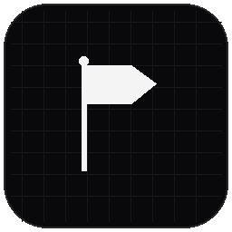
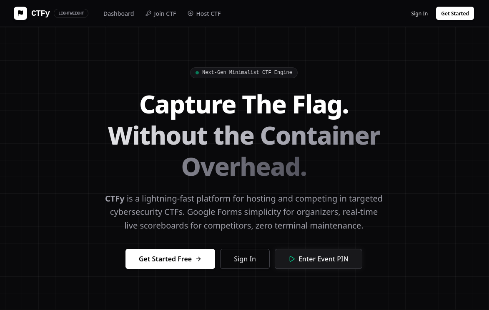
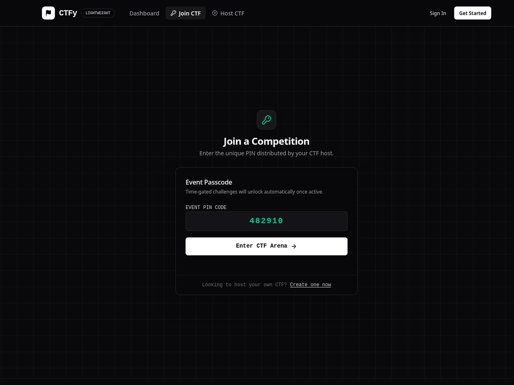
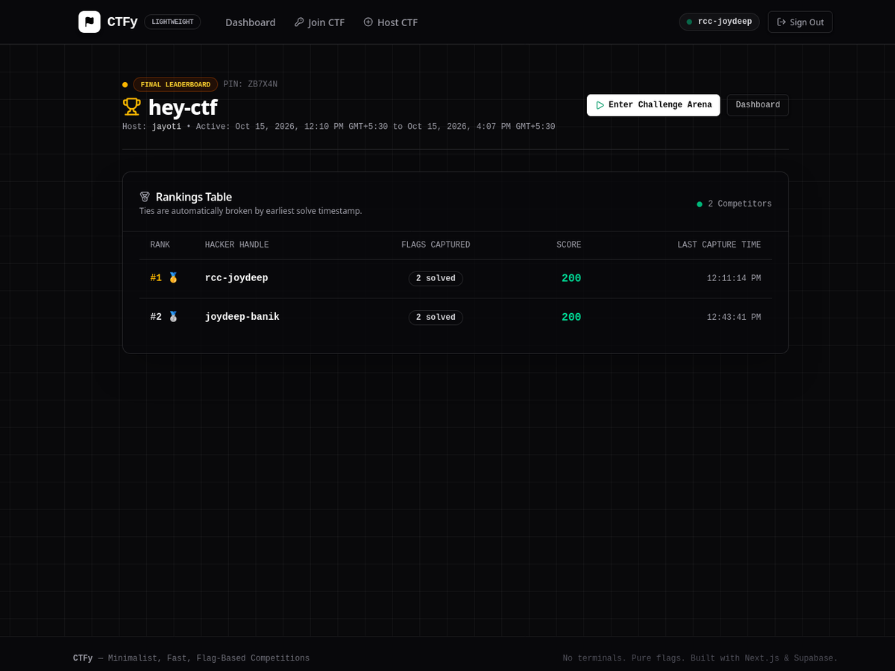
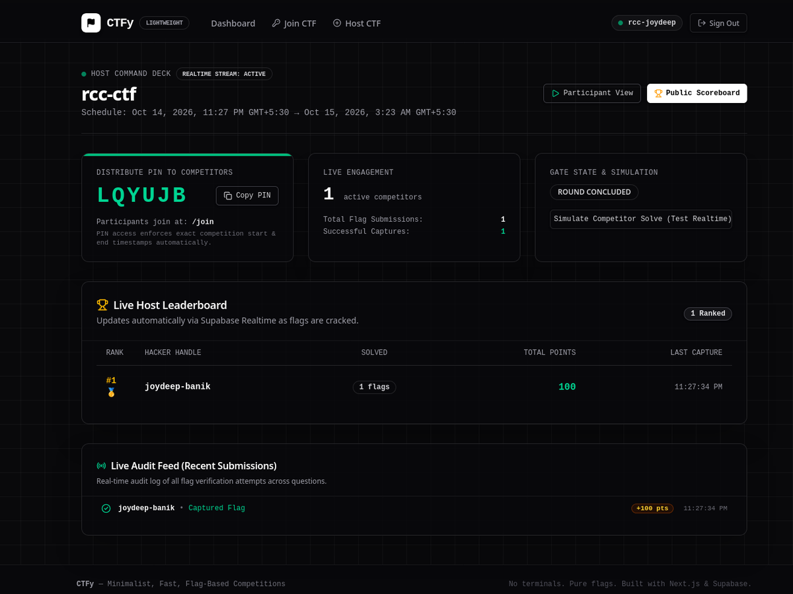
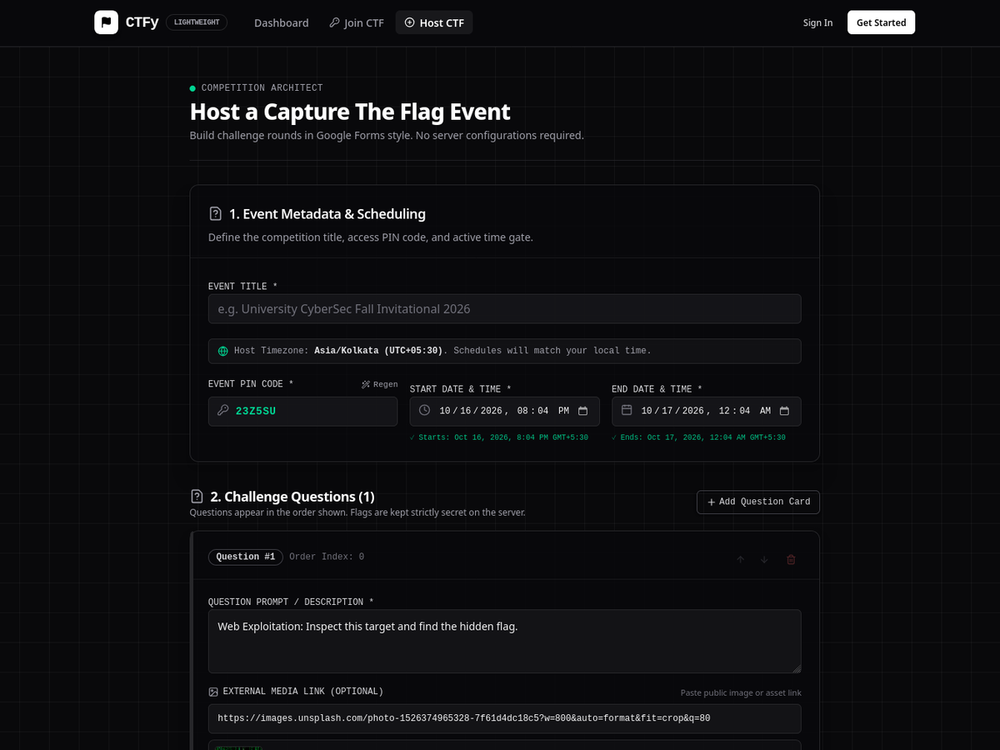

<p align="center">
  
</p>

# CTFy

> **Fast, minimal, and container-free CTF platform for cybersecurity clubs, hackathons, and quiz competitions.**

<p align="center">
  <a href="https://ctfy-blush.vercel.app/">
    
  </a>
  <a href="https://ctfy-blush.vercel.app/host/create">
    
  </a>
  <a href="https://ctfy-blush.vercel.app/">
    
  </a>
</p>

<p align="center">
  
  
  
  
</p>

---



<p align="center">
  <em>Host. Compete. Capture. Score.</em><br />
  A modern CTF competition platform combining PIN-gated arenas, real-time Supabase scoreboards, instant server-side flag verification, and zero-leak security — built for speed and simplicity.
</p>

---

## Why CTFy?

Traditional CTF platforms often require deploying heavy Docker containers, configuring nested virtual networks, and debugging flaky SSH jump-hosts just to run a quiz or security round.

CTFy bridges competition design and instant live hosting into a single, distraction-free environment. You get real-time PIN-gated arenas with markdown challenges and downloadable assets, alongside Supabase-replicated live scoreboards and host telemetry — with zero container maintenance, zero client secret leaks, and full server-side flag verification.

---

## Features

✦ **Instant event creation**: Build multi-question CTFs with markdown prompts, external file/image links, point weights, and secret flags in minutes.  
✦ **PIN-gated competition arenas**: Unique 6-character access codes lock arenas behind backend verification. Competitors cannot view challenges or submit flags without unlocking the event.  
✦ **Zero-leak server architecture**: Isolated secret tables (`event_pins`), host-only RLS policies, server-side flag validation, and zero plaintext flags in Realtime streams. Secret answers are never exposed to client bundles or browser dev tools.  
✦ **Real-time live scoreboard**: Instant rank shifts powered by Supabase Realtime PostgreSQL listeners with dynamic podium calculations and victory confetti.  
✦ **Isolated participant dashboards**: Clean distinction between "Hosted by You" and "Joined Competitions", providing pristine zero-states with no competitor data leakage.  
✦ **Cross-user session protection**: Strict client-state resets, user-scoped input keys, and autofill suppression prevent answer leakage between users on shared devices.  
✦ **Minimalist monochrome cyber UI**: Ultra-fast, accessible dark-mode aesthetic built with Tailwind CSS v4 and shadcn/ui.

| PIN-Gated Arena & Play | Live Realtime Scoreboard |
|:---:|:---:|
|  |  |
| **Host Telemetry Deck** | **Event Question Builder** |
|  |  |

---

## 🛠️ Tech Stack

| Layer | Technology & Version | Purpose |
|---|---|---|
| **Framework** | [Next.js 16.4.0 (Turbopack, App Router)](https://nextjs.org) | Full-stack serverless rendering & Server Actions |
| **Frontend** | [React 19.3.0](https://react.dev), [TypeScript 5](https://www.typescriptlang.org) | Server components, async state, and static typing |
| **Styling & UI** | [Tailwind CSS v4](https://tailwindcss.com), [shadcn/ui](https://ui.shadcn.com) | CSS-first dark theme & accessible Radix UI primitives |
| **Backend & DB** | [Supabase](https://supabase.com) (`@supabase/supabase-js` v2.117, `@supabase/ssr` v0.12) | PostgreSQL, Row Level Security, Auth & Realtime CDC |
| **Validation** | [React Hook Form 7.90](https://react-hook-form.com), [Zod 4.6](https://zod.dev) | High-performance client & server schema validation |
| **Deployment** | [Vercel](https://vercel.com) | Global edge deployment and SSL automation |

> 📦 **Dependencies & Audit Compliance:** For the full dependency version matrix, license audit, and UI component specifications, see [**`DEPENDENCIES.md`**](docs/architecture/DEPENDENCIES.md).

---

## 🚀 Quick Start (Local Development)

### 1. Prerequisites
- [Node.js](https://nodejs.org) >= 20.x
- [npm](https://www.npmjs.com) or [pnpm](https://pnpm.io)
- A free [Supabase](https://supabase.com) project

### 2. Clone Repository
```bash
git clone https://github.com/Joydeep2005Banik/CTFy.git
cd CTFy
npm install
```

### 3. Setup Supabase Database
1. Go to your **[Supabase Dashboard](https://supabase.com/dashboard)** $\rightarrow$ **SQL Editor**.
2. Open [`supabase/schema.sql`](./supabase/schema.sql) in this repository.
3. Paste and run the entire script. This provisions:
   - `profiles`, `events`, `event_pins`, `questions`, `submissions`, and `submission_logs` tables
   - Sanitized `public_questions` view (excluding `correct_answer`)
   - Strict Row Level Security (RLS) policies
   - Automatic user profile sync triggers on signup
   - Safe Realtime publication on `submissions` and `events` tables

### 4. Configure Environment Variables
Create a `.env.local` file in the root directory (or copy from `.env.example`):

```bash
cp .env.example .env.local
```

Fill in your project credentials from your Supabase Dashboard (**Project Settings** $\rightarrow$ **API**):

```env
NEXT_PUBLIC_SUPABASE_URL=https://your-project.supabase.co
NEXT_PUBLIC_SUPABASE_ANON_KEY=eyJhbGciOi...
SUPABASE_SERVICE_ROLE_KEY=your-service-role-key
```

### 5. Run Development Server
```bash
npm run dev
```

Visit [`http://localhost:3000`](http://localhost:3000) in your browser.

---

## 📁 Project Structure

```text
CTFy/
├── public/                 # Static assets & marketing previews
│   └── marketing-assets/   # Clean screenshot captures & brand logo
├── src/
│   ├── app/                # Next.js App Router routes
│   │   ├── dashboard/      # Participant & host dashboard
│   │   ├── events/[id]/
│   │   │   ├── host/       # Host event control deck
│   │   │   ├── play/       # Competitor challenge arena (PIN-gated)
│   │   │   └── scoreboard/ # Public/live realtime leaderboard
│   │   ├── host/create/    # Event creation form
│   │   ├── join/           # PIN-code quick event entrance
│   │   ├── login/          # User authentication (Supabase Auth)
│   │   ├── register/       # User registration
│   │   ├── layout.tsx      # Root layout with brand metadata
│   │   └── page.tsx        # Hero landing page
│   ├── components/         # Reusable UI & navbar components
│   │   ├── ui/             # shadcn/ui primitive components
│   │   └── navbar.tsx      # Responsive navigation header
│   └── lib/                # Core utilities, actions, and validations
│       ├── actions.ts      # Server Actions (secure flag submissions & queries)
│       ├── validations.ts  # Zod schema definitions
│       ├── utils.ts        # Helper functions & localStorage caching
│       └── supabase/       # Client & Server Supabase connectors
└── supabase/
    └── schema.sql          # Complete PostgreSQL schema, RLS, and triggers
```

---

## 🔐 Security Architecture

- **Server-Side Flag Evaluation:** Correct answers (`correct_answer`) in the `questions` table are hidden behind Row Level Security (RLS). The client is never granted direct select permissions on `correct_answer`.
- **Zero-Secret Bundles:** Flag comparisons happen strictly inside `submitFlagAction` in [`src/lib/actions.ts`](./src/lib/actions.ts) using the privileged Supabase Service Role client.
- **PIN Verification:** Access to challenge prompts is restricted to users who verify the 6-character PIN or are the verified creator of the event.
- **Input Sanitization:** Flag inputs disable browser autofill, spellcheck, and credential-manager caching to prevent cross-account answer leaks on shared computers.
- 🏛️ **Full Technical Breakdown:** See [**`ARCHITECTURE.md`**](docs/architecture/ARCHITECTURE.md) for Mermaid sequence diagrams, database ERD, and real-time state synchronization flows.

---

## 🚩 Competition & Organizer Guides

Whether you are hosting an event, designing challenges, or competing, explore our dedicated guides:
- 📖 [**Hosting Guide**](docs/guides/HOSTING_GUIDE.md): Master the art of designing and hosting CTF events.
- 🎯 [**Participant Guide**](docs/guides/PARTICIPANT_GUIDE.md): How to join with a PIN code, submit flags, and track live standings.
- 🧩 [**Challenge Authoring & Question Design**](docs/guides/CHALLENGE_AUTHORING.md): Blueprints for creating fair, engaging CTF challenges without containers.
- 📋 [**Event Day Operations & Anti-Cheat Playbook**](docs/guides/EVENT_OPERATIONS.md): Operational timeline, anti-cheat detection, live errata, and podium verification.
- 📜 [**Competition Rules Template**](docs/guides/COMPETITION_RULES_TEMPLATE.md): Turnkey tournament rules and code of conduct for organizers.

---

## 🚀 Deployment & Operations

Production deployment procedures, self-hosting configurations, and tactical support:
- 🚀 [**Deployment & Self-Hosting Guide**](docs/operations/DEPLOYMENT.md): Step-by-step instructions for Vercel, Docker, and Linux VPS self-hosting.
- 🔍 [**Troubleshooting Guide & Runbook**](docs/operations/TROUBLESHOOTING.md): Solutions for email confirmation, PIN unlock, and realtime issues.

---

## 🏛️ Architecture & System Engineering

In-depth technical architecture, data contracts, and codebase structure:
- 🛠️ [**System Design & Engineering**](docs/architecture/SYSTEM_DESIGN.md): Concurrency model, high-throughput scaling, and fault tolerance.
- 🏛️ [**Architecture & Data Flow**](docs/architecture/ARCHITECTURE.md): System topology, Mermaid sequence diagrams, and security architecture.
- 🗄️ [**Database & RLS Reference**](docs/architecture/DATABASE.md): PostgreSQL data dictionary, indexes, and Row Level Security matrix.
- 🔌 [**Server Actions & API Reference**](docs/architecture/API_REFERENCE.md): Full technical contract for server actions, Zod schemas, and error handling.
- 🌲 [**Project Structure & Codebase Map**](docs/architecture/PROJECT_STRUCTURE.md): Detailed visual tree and file-by-file breakdown.
- 📦 [**Dependencies & Audit Compliance**](docs/architecture/DEPENDENCIES.md): Full package version matrix, license review, and UI component registry.

---

## 🤝 Community & Contributing

Project standards, contribution workflows, and product roadmap:
- 🗺️ [**Product Roadmap**](ROADMAP.md): Strategic vision, upcoming milestones (Team Mode, timers, dynamic scoring).
- 🛠️ [**Contributing Guide**](CONTRIBUTING.md): Workflow guidelines, branch standards, and PR instructions.
- 📜 [**Code of Conduct**](CODE_OF_CONDUCT.md): Our community commitment to an inclusive environment.
- 🔒 [**Security Policy**](SECURITY.md): Responsible vulnerability disclosure guidelines.
- 🐛 [**Issue Templates**](.github/ISSUE_TEMPLATE/): Report bugs or submit feature proposals.
- 📜 [**Changelog**](CHANGELOG.md): Complete history of platform features and bug fixes.
- 📚 [**Documentation Hub**](docs/README.md): Central portal and index for all platform documentation.

---

## 📄 License

This project is licensed under the [MIT License](LICENSE) — see the [LICENSE](LICENSE) file for details.
