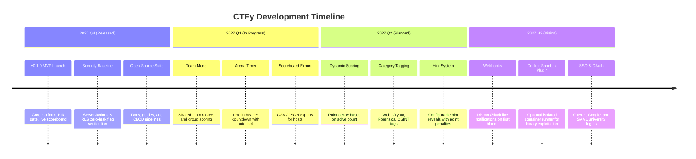

# CTFy Product Roadmap 🗺️

This document outlines the strategic vision, upcoming milestones, and architectural evolution of the **CTFy** platform.

---

## 🎯 Guiding Product Pillars

1. **Zero-Overhead Competition Hosting:** Keep event creation as simple as filling out a form, without requiring Docker daemons or virtual machines.
2. **Absolute Secret Protection:** Maintain a zero-leak guarantee where challenge answers and host keys are never exposed to client browsers.
3. **Real-Time Responsiveness:** Deliver instantaneous score updates and live podium re-ranking with sub-second latency.
4. **Accessible, Minimalist Design:** Ensure a distraction-free, accessible monochrome experience on all devices.

---

## 📅 Roadmap Overview

---

## 🚀 Phase 1: Near-Term Enhancements (Q1 2027)

### 1. Team Mode & Collaboration
- **Description:** Allow competitors to form or join teams under a single shared team score.
- **Key Features:**
  - Unique team invite codes.
  - Shared solve status across team members.
  - Team member limit configured by host (e.g. 1 to 5 members).
- **Technical Scope:** Add `teams` and `team_members` tables with PostgreSQL RLS policies.

### 2. Live Competition Countdown Clock
- **Description:** A persistent, dynamic timer in the Arena and Scoreboard headers.
- **Key Features:**
  - Live ticking timer with color warning states (normal, 15m remaining, 5m final sprint).
  - Synchronized server timestamping to prevent client clock manipulation.
  - Automatic input freeze when timer hits 00:00:00.

### 3. Scoreboard & Submission Log Export
- **Description:** One-click data exports for event organizers.
- **Key Features:**
  - Export final standings as `.csv` or `.json`.
  - Export detailed submission audit logs (timestamps, user, question, submitted flag, pass/fail).

---

## 🔮 Phase 2: Competition Mechanics (Q2 2027)

### 4. Dynamic Scoring & Point Decay
- **Description:** Rewarding early solvers and adjusting points dynamically as more players solve a challenge.
- **Formula:** 
  $$\text{Points} = \text{Minimum} + (\text{Maximum} - \text{Minimum}) \times \left(1 - \frac{\text{solves}}{\text{total\_solves} + \text{decay\_rate}}\right)$$
- **First Blood Badges:** Special visual recognition on the scoreboard for the first player/team to solve a challenge.

### 5. Challenge Categorization & Filtering
- **Description:** Organize challenges into standard cybersecurity domains.
- **Categories:** `Cryptography`, `Web Exploitation`, `Forensics`, `Reverse Engineering`, `OSINT`, and `Trivia`.
- **Filtering:** Filter challenge cards by category, point value, or solved status in the arena.

### 6. Interactive Hint System
- **Description:** Optional hints that players can unlock by taking a small point penalty.
- **Host Controls:** Hosts can set up to 3 tiered hints per question with custom penalty weights (e.g., -5 pts, -15 pts).

---

## 🌐 Phase 3: Platform & Ecosystem (H2 2027+)

### 7. Webhook Integrations (Discord & Slack)
- **Description:** Real-time event notifications pushed to event Discord/Slack channels.
- **Events:**
  - Event Start / Event End warnings.
  - "First Blood" broadcasts when a difficult challenge is cracked.
  - Final podium announcement upon competition completion.

### 8. Single Sign-On (SSO) & University Auth
- **Description:** One-click authentication using GitHub, Google, or university SAML/OIDC providers.
- **Target Audience:** University clubs and hackathons requiring student email verification (`.edu`).

### 9. Optional Container Runner Plugin (CTFy Cloud Sandbox)
- **Description:** For advanced events requiring live server exploitation, provide an optional micro-sandbox plugin (Firecracker or WebAssembly microVMs) while keeping the core platform 100% lightweight.

---

## 🗳️ How Community Members Can Influence the Roadmap

- **Vote on Features:** React with 👍 to existing proposals in [GitHub Issues](https://github.com/Joydeep2005Banik/CTFy/issues).
- **Propose New Ideas:** Open a discussion using our [Feature Request Template](.github/ISSUE_TEMPLATE/feature_request.md).
- **Champion an Implementation:** Comment on any roadmap item you would like to build, and we will help you draft an RFC and review your PR!
