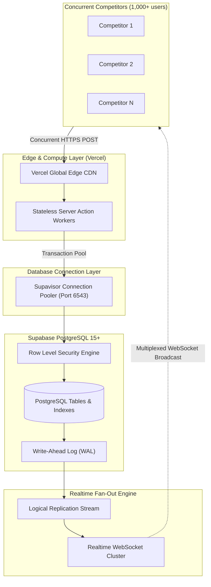
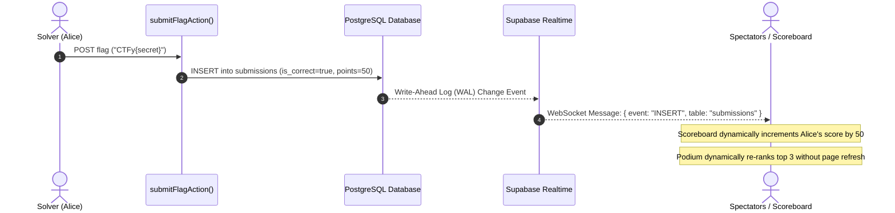

# CTFy System Design & Engineering Specifications 🛠️

This document outlines the system engineering specifications, concurrency model, high-throughput scaling strategies, and fault tolerance architecture powering **CTFy**.

---

## 1. System Engineering Principles

CTFy was built to solve the primary point of failure in traditional CTF platforms: **infrastructure fragility**.

```
Traditional CTF Infrastructure:
[User] -> [Reverse Proxy] -> [Heavy Docker Daemons] -> [SSH Jump-hosts] -> [Crash/Hung Container]

CTFy Zero-Overhead Infrastructure:
[User] -> [Vercel Global Edge] -> [Next.js Server Actions] -> [Supabase PostgreSQL (RLS)] -> [Supabase Realtime]
```

### Core Architecture Tenets:
1. **Stateless Compute:** All Next.js compute runs in stateless serverless runtime environments. No sticky sessions or persistent daemon state.
2. **Push over Poll:** Instead of hundreds of competitor browsers polling `/api/scoreboard` every few seconds, we utilize PostgreSQL Change Data Capture (CDC) over a single persistent WebSocket per client.
3. **Defense in Depth:** Zero-trust architecture where challenge answers are never exposed in database views, API serialization, or client hydration bundles.

---

## 2. High-Throughput Concurrency & Scaling Model

During hackathons or university contests, hundreds or thousands of competitors often submit flags simultaneously in the final minutes of a round.



### 1. Connection Pooling via Supavisor
- Traditional PostgreSQL servers choke when 500+ direct connections open simultaneously.
- CTFy connects to Supabase using **Supavisor** (transaction pooler on port `6543`), allowing thousands of concurrent serverless requests to share a minimal pool of physical database connections with zero connection exhaustion.

### 2. High-Throughput Indexing
To keep flag validation and leaderboard queries under 10ms regardless of database volume:
- `idx_events_pin`: Hash-based index on `events.pin_code` for $O(1)$ PIN validation.
- `idx_questions_event`: Composite index on `questions(event_id, order_index asc)` for instant challenge rendering.
- `idx_submissions_user_question`: Composite index on `submissions(user_id, question_id, is_correct)` preventing duplicate score awards in a single indexed scan.

---

## 3. Real-Time Broadcasting & State Synchronization

CTFy avoids expensive polling by streaming database mutation events directly to connected clients:



### WebSocket Channel Multiplexing:
- **Scoreboard Channel:** Subscribes to `submissions` filtered by `event_id=eq.{id}`. Only receives submissions relevant to the active competition.
- **Host Channel:** Subscribes to live audit stream, receiving both correct and incorrect attempt notices for organizer monitoring.

---

## 4. Fault Tolerance, Resilience & Edge Cases

| Failure Scenario | System Behavior | Mitigation Strategy |
|---|---|---|
| **Temporary Network Drop** | Competitor temporarily loses Wi-Fi while submitting. | The browser retries the action. `submissions` table uses a unique constraint check so duplicate clicks do not award double points. |
| **Scoreboard WebSocket Disconnect** | Browser tab sleeps or network blips. | Supabase Realtime client automatically performs exponential backoff reconnection. On reconnect, the component does a clean fetch to reconcile state. |
| **Clock Skew / Timezone Discrepancies** | Competitor's machine clock is set incorrectly. | **All verification is server-authoritative.** The Next.js server validates `now() >= start_time && now() <= end_time` against PostgreSQL's synchronized UTC clock. Client clock offsets cannot bypass event deadlines. |
| **Shared Computer Station** | Competitor A logs out, Competitor B signs in on the same browser. | Session transitions perform full hard window redirections (`window.location.href`), purging all React memory states, while input fields use unique user-scoped names to prevent browser password managers from injecting prior answers. |

---

## 5. Security & Isolation Boundaries

```
[Untrusted Client: Competitor Browser]
       │
       │ (1) Cannot query questions.correct_answer (BLOCKED BY RLS)
       │ (2) Cannot select other users' submissions (BLOCKED BY RLS)
       ▼
[Trusted Boundary: Next.js Server Action]
       │
       │ (3) Validates authenticated session cookie
       │ (4) Uses Supabase Service Role Key to read secret flag
       │ (5) Compares strings inside Node.js memory
       ▼
[Protected Database: Supabase PostgreSQL]
       │
       │ (6) Inserts verified record into public.submissions
```

1. **Client Isolation:** The client receives only a boolean pass/fail status and points awarded.
2. **Database Isolation:** Row Level Security (RLS) ensures that even if a competitor acquires the public Anon API key, they cannot query answers or tamper with other competitors' submissions.
3. **Admin Isolation:** Host control tools (`/events/[id]/host`) verify that the active user's ID matches `event.host_id` before rendering metrics or submission logs.
