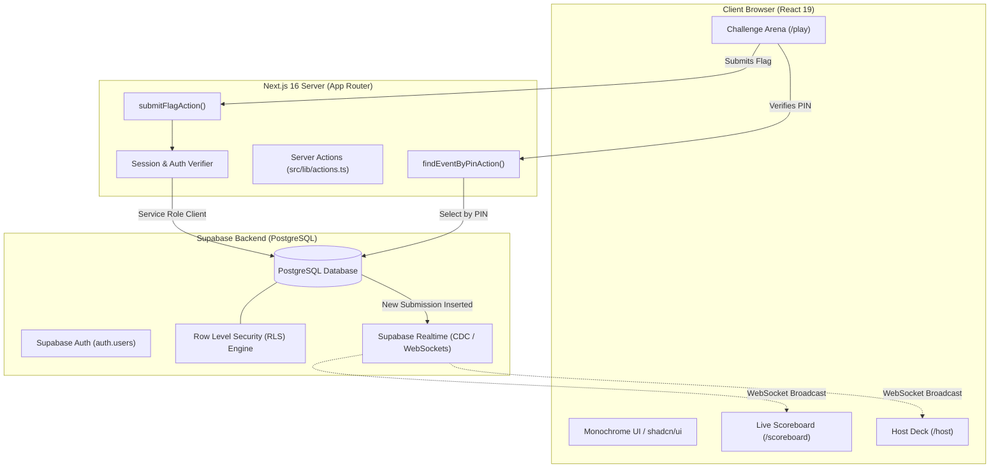
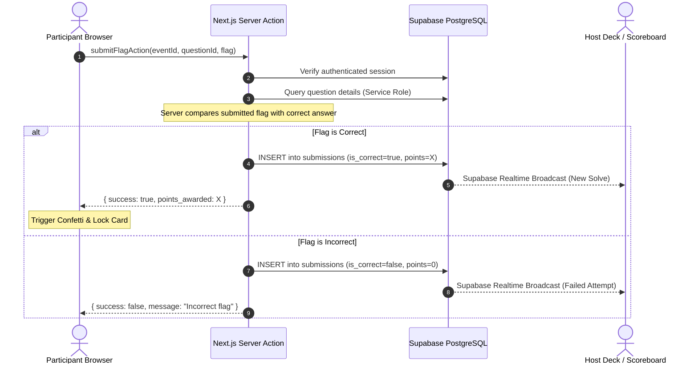
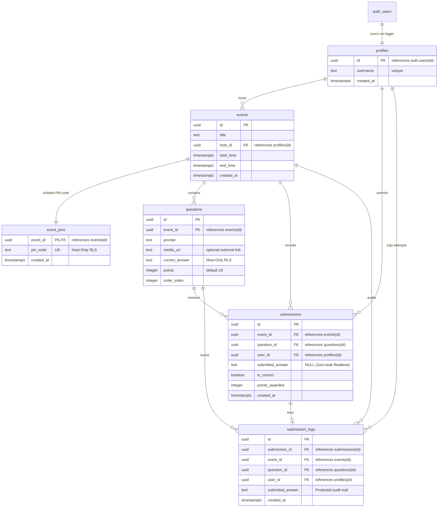
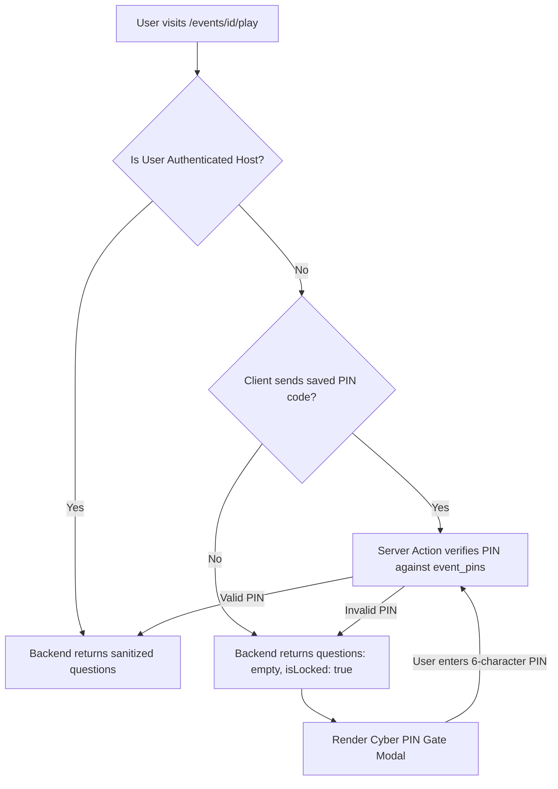

# CTFy Architecture & Technical System Design 🏛️

This document details the architectural design, security boundaries, database relationships, and real-time data flows powering **CTFy**.

---

## 1. High-Level Architecture Overview

CTFy is designed to eliminate the infrastructure overhead, flaky SSH tunnels, and container crashes common to traditional CTF platforms. It operates as a full-stack, serverless application with strict separation between public event metadata and privileged flag validation.

---

## 2. Core Security Model: Zero-Leak Flag Architecture

In standard client-rendered applications, naive implementations often leak challenge solutions to the browser via JSON API responses or client-side evaluation. 

**CTFy enforces a strict Zero-Leak Guarantee:**

1. **Row Level Security (RLS):** 
   - The `correct_answer` column in the `questions` table is locked down. Standard authenticated participants and anonymous visitors have zero `SELECT` privileges on the `correct_answer` column.
2. **Server-Side Evaluation:**
   - Flag validation runs exclusively inside `submitFlagAction` on the Next.js server.
   - The server verifies the participant's authenticated session, fetches the question's secret answer using the privileged Supabase Service Role client, compares the strings on the server, and records the score.
3. **Information Hiding:**
   - The client only receives a boolean status (`isCorrect: true/false`), awarded points, and an error message. The secret answer never touches the client bundle, DOM, or browser memory.

### Flag Submission Sequence Diagram

---

## 3. Database Schema & Entity Relationship Diagram (ERD)

The database schema is structured around a hardened, zero-leak relational model with strict Row Level Security (RLS):

### Key Schema Optimizations & Security Layers:
- **Zero-Leak PIN Isolation:** Competition PINs are segregated into `event_pins` with strict host-only RLS (`auth.uid() = host_id`). The public `events` table contains zero credentials, preventing scraping.
- **Sanitized Public Questions View:** Competitors never query the `questions` table directly. The `public_questions` view and Server Actions explicitly exclude `correct_answer`.
- **Zero-Leak Realtime Scoreboard:** The `submissions.submitted_answer` column is kept `NULL`. Supabase Realtime CDC broadcasts solely scoring status (`is_correct`, `points_awarded`) over WebSocket channels.
- **Private Audit Trail:** Actual submitted answer strings are stored in `submission_logs` protected by submitter-and-host-only RLS policies (`auth.uid() = user_id OR auth.uid() = host_id`).
- **High-Throughput B-Tree Indexes:** Dedicated indexes on `event_pins(pin_code)`, `events(host_id)`, `questions(event_id, order_index)`, and `submissions(event_id, created_at)` ensure sub-millisecond query performance during high-throughput competitions.
- **Cascade Deletions:** Deleting an event cleanly purges associated questions, PINs, submissions, and audit logs automatically via `ON DELETE CASCADE`.

---

## 4. Real-Time State Management

CTFy leverages **PostgreSQL Change Data Capture (CDC)** via Supabase Realtime to update leaderboards and organizer logs without client polling:

1. **Submissions Table Publication:**
   - The `submissions` table is added to `supabase_realtime`. It transmits only safe scoring telemetry, completely immune to flag leakage.
2. **WebSocket Channels:**
   - The live Scoreboard subscribes to channel `realtime:scoreboard-[eventId]` with column filters.
   - The Host Deck subscribes to channel `realtime:host-deck-[eventId]`.
3. **Instant Re-Ranking:**
   - When a valid solve occurs, an `INSERT` event fires over the WebSocket connection.
   - The scoreboard client recalculates scores and dynamically shifts the top-3 podium and table rows without a page refresh.

---

## 5. PIN Gate & Backend Verification Architecture

To prevent unauthorized scraping and shared-station cross-pollution:

- **Server-Authoritative Gate:** The frontend never decides whether questions should be visible based purely on local state. The Server Action (`getEventQuestionnaireAction`) refuses to send challenge prompts to any client unless the host identity or matching PIN is verified server-side.
- **Autofill Suppression:** Challenge inputs feature dynamic user-scoped name attributes (`ctfy_flag_${userId}_${questionId}`) and `autoComplete="off"`, `data-lpignore="true"` to prevent browser password managers or autofill from leaking prior players' answers on shared competition terminals.
- **Full DOM Transitions:** Session transitions (login and logout) use clean full-window reloads (`window.location.href`) to ensure all in-memory React states and cached closures are destroyed.

---

## 6. Technology Stack Summary

| Component | Choice | Rationale |
|---|---|---|
| **Framework** | Next.js 16 (App Router) | High-performance React 19 server-side rendering and Server Actions. |
| **Compiler** | Turbopack | Sub-second local builds and optimized production tree-shaking. |
| **Styling** | Tailwind CSS v4 + shadcn/ui | Minimalist, dark-mode first design with accessible Radix primitives. |
| **Database** | PostgreSQL (Supabase) | ACID compliance, Row Level Security, and automated user profile sync triggers. |
| **Realtime** | Supabase Realtime | WebSocket replication with zero Redis or Socket.io infrastructure to maintain. |
| **Validation** | Zod + React Hook Form | Type-safe form validation for event dates, questionnaires, and flag formats. |
