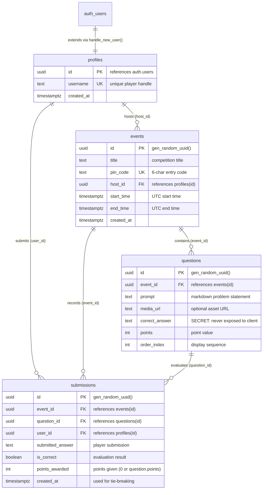

# Database Architecture & RLS Security Reference 🗄️

This document provides the complete data dictionary, relational schema, indexing strategy, and Row Level Security (RLS) matrix for **CTFy**. 

CTFy utilizes **PostgreSQL** hosted on **Supabase** with logical replication (CDC) enabled for real-time scoreboard synchronization.

---

## Table of Contents
1. [Entity Relationship Diagram (ERD)](#1-entity-relationship-diagram-erd)
2. [Table Data Dictionary](#2-table-data-dictionary)
   - [`profiles`](#profiles)
   - [`events`](#events)
   - [`questions`](#questions)
   - [`submissions`](#submissions)
3. [Indexing & Query Optimization](#3-indexing--query-optimization)
4. [Row Level Security (RLS) Policy Matrix](#4-row-level-security-rls-policy-matrix)
5. [Database Triggers & Automated Profiles](#5-database-triggers--automated-profiles)
6. [Realtime Logical Replication (CDC)](#6-realtime-logical-replication-cdc)
7. [Essential DBA & Maintenance Queries](#7-essential-dba--maintenance-queries)

---

## 1. Entity Relationship Diagram (ERD)



---

## 2. Table Data Dictionary

### `profiles`
Extends `auth.users` to provide public usernames for scoreboards without exposing user email addresses.

| Column | Type | Constraints | Description |
|---|---|---|---|
| `id` | `uuid` | `PRIMARY KEY`, `REFERENCES auth.users(id) ON DELETE CASCADE` | Matches the authenticated Supabase user UID. |
| `username` | `text` | `NOT NULL`, `UNIQUE` | Public handle displayed on leaderboards and podiums. |
| `created_at` | `timestamptz` | `NOT NULL`, `DEFAULT now()` | Account creation timestamp. |

---

### `events`
Stores competition metadata, access PINs, scheduling windows, and host ownership.

| Column | Type | Constraints | Description |
|---|---|---|---|
| `id` | `uuid` | `PRIMARY KEY`, `DEFAULT gen_random_uuid()` | Unique event identifier. |
| `title` | `text` | `NOT NULL` | Name of the CTF competition. |
| `pin_code` | `text` | `NOT NULL`, `UNIQUE` | 6-character alphanumeric code required to enter the arena. |
| `host_id` | `uuid` | `NOT NULL`, `REFERENCES profiles(id) ON DELETE CASCADE` | Creator/organizer of the competition. |
| `start_time` | `timestamptz` | `NOT NULL` | Scheduled competition start (stored in UTC). |
| `end_time` | `timestamptz` | `NOT NULL` | Scheduled competition close (stored in UTC). |
| `created_at` | `timestamptz` | `NOT NULL`, `DEFAULT now()` | Creation timestamp. |

---

### `questions`
Contains challenge prompts, points, media links, and the secret flag answer.

| Column | Type | Constraints | Description |
|---|---|---|---|
| `id` | `uuid` | `PRIMARY KEY`, `DEFAULT gen_random_uuid()` | Unique challenge question ID. |
| `event_id` | `uuid` | `NOT NULL`, `REFERENCES events(id) ON DELETE CASCADE` | Associated event. |
| `prompt` | `text` | `NOT NULL` | Markdown-supported problem statement and hints. |
| `media_url` | `text` | `NULLABLE` | Link to external PCAP, binary, or image download. |
| `correct_answer` | `text` | `NOT NULL` | **CRITICAL SECRET:** Secret flag. Shielded by server actions and RLS. |
| `points` | `integer` | `NOT NULL`, `DEFAULT 10` | Points awarded upon first successful capture. |
| `order_index` | `integer` | `NOT NULL`, `DEFAULT 0` | Sequence order inside the competition arena. |

---

### `submissions`
High-write log recording every flag submission attempt, evaluation outcome, and points awarded.

| Column | Type | Constraints | Description |
|---|---|---|---|
| `id` | `uuid` | `PRIMARY KEY`, `DEFAULT gen_random_uuid()` | Unique submission log record. |
| `event_id` | `uuid` | `NOT NULL`, `REFERENCES events(id) ON DELETE CASCADE` | Target event. |
| `question_id` | `uuid` | `NOT NULL`, `REFERENCES questions(id) ON DELETE CASCADE` | Target challenge. |
| `user_id` | `uuid` | `NOT NULL`, `REFERENCES profiles(id) ON DELETE CASCADE` | Submitting player. |
| `submitted_answer` | `text` | `NOT NULL` | Raw string input submitted by the user. |
| `is_correct` | `boolean` | `NOT NULL`, `DEFAULT false` | True if the submission matched `correct_answer`. |
| `points_awarded` | `integer` | `NOT NULL`, `DEFAULT 0` | Points granted (0 for incorrect or duplicate solves). |
| `created_at` | `timestamptz` | `NOT NULL`, `DEFAULT now()` | Exact submission timestamp (used for tie-breaking). |

---

## 3. Indexing & Query Optimization

To maintain sub-50ms queries under heavy concurrent flag submissions, the schema defines five targeted compound and single-column indexes:

| Index Name | Table | Columns | Optimized Query Pattern |
|---|---|---|---|
| `idx_events_pin` | `events` | `pin_code` | Instant O(1) PIN lookups when unlocking an arena (`findEventByPinAction`). |
| `idx_events_host` | `events` | `host_id` | Dashboard queries filtering "Hosted by You" events. |
| `idx_questions_event` | `questions` | `event_id, order_index ASC` | Arena loading in display sequence. |
| `idx_submissions_event` | `submissions` | `event_id, created_at DESC` | Host Deck live ingestion feed and Realtime broadcast streaming. |
| `idx_submissions_user_question` | `submissions` | `user_id, question_id, is_correct` | Sub-millisecond verification of whether a user already solved a challenge. |

---

## 4. Row Level Security (RLS) Policy Matrix

PostgreSQL Row Level Security (RLS) guarantees that unprivileged browser connections cannot tamper with data or steal secret flags:

| Table | Operation | `anon` (Unauthenticated) | `authenticated` (Participant) | `service_role` (Backend Secret) |
|---|---|---|---|---|
| **`profiles`** | `SELECT` | ✅ View all | ✅ View all | ✅ Full Access |
| | `INSERT` | ❌ Denied | ✅ Own record (`auth.uid() = id`) | ✅ Full Access |
| | `UPDATE` | ❌ Denied | ✅ Own record (`auth.uid() = id`) | ✅ Full Access |
| **`events`** | `SELECT` | ✅ View all | ✅ View all | ✅ Full Access |
| | `INSERT` | ❌ Denied | ✅ If `host_id = auth.uid()` | ✅ Full Access |
| | `UPDATE` | ❌ Denied | ✅ If `host_id = auth.uid()` | ✅ Full Access |
| | `DELETE` | ❌ Denied | ✅ If `host_id = auth.uid()` | ✅ Full Access |
| **`questions`** | `SELECT` | ❌ Denied | ⚠️ Read all (Host only sees `correct_answer` via UI) | ✅ Full Access |
| | `INSERT` | ❌ Denied | ✅ If Event Host | ✅ Full Access |
| | `UPDATE` | ❌ Denied | ✅ If Event Host | ✅ Full Access |
| **`submissions`** | `SELECT` | ✅ View all (Scoreboard) | ✅ View all (Scoreboard) | ✅ Full Access |
| | `INSERT` | ❌ Denied | ✅ Own submissions (`auth.uid() = user_id`) | ✅ Full Access |
| | `UPDATE` | ❌ Denied | ❌ Denied (Logs are immutable) | ✅ Full Access |

> 🔒 **The Flag Secrecy Guarantee:** 
> Even though participants have SELECT permissions on `questions`, the Next.js frontend **never queries `questions` directly from the browser**. Challenge prompts are loaded via sanitized server actions (`getPublicQuestionsAction`) which explicitly strip the `correct_answer` column before returning JSON to the client.

---

## 5. Database Triggers & Automated Profiles

When a user signs up via Supabase Auth (`auth.users`), a PostgreSQL trigger automatically syncs a public profile to `public.profiles`:

```sql
create or replace function public.handle_new_user()
returns trigger as $$
declare
  raw_username text;
begin
  raw_username := coalesce(
    new.raw_user_meta_data->>'username',
    split_part(new.email, '@', 1),
    'agent_' || substr(new.id::text, 1, 6)
  );

  insert into public.profiles (id, username, created_at)
  values (new.id, raw_username, now())
  on conflict (id) do update
  set username = excluded.username;

  return new;
end;
$$ language plpgsql security definer;

-- Trigger execution on auth.users INSERT
create trigger on_auth_user_created
  after insert on auth.users
  for each row execute function public.handle_new_user();
```

---

## 6. Realtime Logical Replication (CDC)

CTFy leverages PostgreSQL logical decoding to push instantaneous scoreboard updates over WebSockets:

```sql
-- Adds the submissions table to the Supabase Realtime publication
alter publication supabase_realtime add table public.submissions;
```

When a user submits a flag:
1. `submitFlagAction` inserts a record into `public.submissions`.
2. PostgreSQL emits an `INSERT` event to the WAL (Write-Ahead Log).
3. The Supabase Realtime server reads the WAL and broadcasts the payload to all clients subscribed to `event-${eventId}-submissions`.
4. The client's `useRealtimeScoreboard` hook recalculates ranks, triggers podium animations, and displays confetti.

---

## 7. Essential DBA & Maintenance Queries

### Recipe 1: Export Complete Competition Scoreboard to CSV
Execute in the Supabase SQL Editor:
```sql
select 
  dense_rank() over (order by sum(s.points_awarded) desc, max(s.created_at) asc) as rank,
  p.username,
  sum(s.points_awarded) as total_points,
  count(distinct s.question_id) filter (where s.is_correct) as flags_captured,
  max(s.created_at) as last_solve_time
from public.submissions s
join public.profiles p on p.id = s.user_id
where s.event_id = '<YOUR_EVENT_ID>'
group by p.id, p.username
order by rank asc;
```

---

### Recipe 2: Safely Purge Test Submissions Before Event Launch
Remove all test solves made during organizer dry-runs:
```sql
delete from public.submissions
where event_id = '<YOUR_EVENT_ID>';
```

---

### Recipe 3: Recalculate Points Following a Challenge Point Value Change
If an organizer updates a question's points from 100 to 200 mid-event:
```sql
update public.submissions s
set points_awarded = q.points
from public.questions q
where s.question_id = q.id
  and s.event_id = '<YOUR_EVENT_ID>'
  and s.is_correct = true;
```

---

### Recipe 4: Anti-Cheat — Detect Submission Bursts (Brute Force Detection)
Identify users submitting more than 10 attempts in a 60-second window:
```sql
select 
  user_id,
  p.username,
  count(*) as attempt_count,
  min(s.created_at) as burst_start,
  max(s.created_at) as burst_end
from public.submissions s
join public.profiles p on p.id = s.user_id
where s.event_id = '<YOUR_EVENT_ID>'
group by user_id, p.username, date_trunc('minute', s.created_at)
having count(*) > 10
order by attempt_count desc;
```
