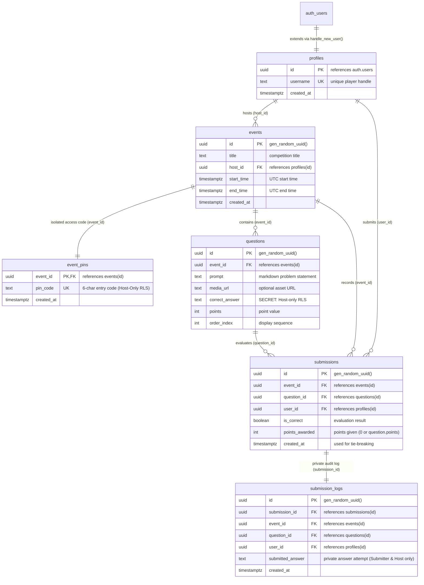

# Database Architecture & Hardened RLS Security Reference 🗄️

This document provides the complete data dictionary, relational schema, indexing strategy, and Row Level Security (RLS) matrix for **CTFy**. 

CTFy utilizes **PostgreSQL** hosted on **Supabase** with logical replication (CDC) enabled for real-time scoreboard synchronization, hardened against client-side flag extraction, score forgery, and PIN scraping.

---

## Table of Contents
1. [Entity Relationship Diagram (ERD)](#1-entity-relationship-diagram-erd)
2. [Table Data Dictionary](#2-table-data-dictionary)
   - [`profiles`](#profiles)
   - [`events`](#events)
   - [`event_pins`](#event_pins)
   - [`questions`](#questions)
   - [`submissions`](#submissions)
   - [`submission_logs`](#submission_logs)
3. [Indexing & Query Optimization](#3-indexing--query-optimization)
4. [Row Level Security (RLS) Policy Matrix](#4-row-level-security-rls-policy-matrix)
5. [Database Triggers & Automated Profiles](#5-database-triggers--automated-profiles)
6. [Realtime Logical Replication (CDC)](#6-realtime-logical-replication-cdc)
7. [Essential DBA & Maintenance Queries](#7-essential-dba--maintenance-queries)

---

## 1. Entity Relationship Diagram (ERD)



---

## 2. Table Data Dictionary

### `profiles`
Extends `auth.users` to provide public usernames for scoreboards without exposing user email addresses.

| Column | Type | Constraints | Description |
|---|---|---|---|
| `id` | `uuid` | `PRIMARY KEY`, `REFERENCES auth.users(id) ON DELETE CASCADE` | Matches the authenticated Supabase user UID. |
| `username` | `text` | `NOT NULL`, `UNIQUE` | Public handle displayed on leaderboards and podiums. |
| `created_at` | `timestamptz` | `NOT NULL`, `DEFAULT now()` | Account creation timestamp. |

---

### `events`
Stores public competition metadata, scheduling windows, and host ownership. `pin_code` is isolated in `event_pins` to prevent public scraping.

| Column | Type | Constraints | Description |
|---|---|---|---|
| `id` | `uuid` | `PRIMARY KEY`, `DEFAULT gen_random_uuid()` | Unique event identifier. |
| `title` | `text` | `NOT NULL` | Name of the CTF competition. |
| `host_id` | `uuid` | `NOT NULL`, `REFERENCES profiles(id) ON DELETE CASCADE` | Creator/organizer of the competition. |
| `start_time` | `timestamptz` | `NOT NULL` | Scheduled competition start (stored in UTC). |
| `end_time` | `timestamptz` | `NOT NULL` | Scheduled competition close (stored in UTC). |
| `created_at` | `timestamptz` | `NOT NULL`, `DEFAULT now()` | Creation timestamp. |

---

### `event_pins`
Protected table storing competition PIN access codes. Protected by host-only Row Level Security.

| Column | Type | Constraints | Description |
|---|---|---|---|
| `event_id` | `uuid` | `PRIMARY KEY`, `REFERENCES events(id) ON DELETE CASCADE` | Target event. |
| `pin_code` | `text` | `NOT NULL`, `UNIQUE` | 6-character access PIN. Accessible only by the host. |
| `created_at` | `timestamptz` | `NOT NULL`, `DEFAULT now()` | Creation timestamp. |

---

### `questions`
Contains challenge prompts, points, media links, and the secret flag answer. **Direct SELECT is restricted strictly to the event host.**

| Column | Type | Constraints | Description |
|---|---|---|---|
| `id` | `uuid` | `PRIMARY KEY`, `DEFAULT gen_random_uuid()` | Unique challenge question ID. |
| `event_id` | `uuid` | `NOT NULL`, `REFERENCES events(id) ON DELETE CASCADE` | Associated event. |
| `prompt` | `text` | `NOT NULL` | Markdown-supported problem statement and hints. |
| `media_url` | `text` | `NULLABLE` | Link to external PCAP, binary, or image download. |
| `correct_answer` | `text` | `NOT NULL` | **CRITICAL SECRET:** Secret flag. Shielded by host-only RLS and server actions. |
| `points` | `integer` | `NOT NULL`, `DEFAULT 10` | Points awarded upon first successful capture. |
| `order_index` | `integer` | `NOT NULL`, `DEFAULT 0` | Sequence order inside the competition arena. |

---

### `submissions`
Public scoreboard table recording flag captures, timestamps, and awarded points. **Does NOT contain plaintext answers**, completely eliminating flag leakage via public SELECT or Supabase Realtime streams.

| Column | Type | Constraints | Description |
|---|---|---|---|
| `id` | `uuid` | `PRIMARY KEY`, `DEFAULT gen_random_uuid()` | Unique submission record. |
| `event_id` | `uuid` | `NOT NULL`, `REFERENCES events(id) ON DELETE CASCADE` | Target event. |
| `question_id` | `uuid` | `NOT NULL`, `REFERENCES questions(id) ON DELETE CASCADE` | Target challenge. |
| `user_id` | `uuid` | `NOT NULL`, `REFERENCES profiles(id) ON DELETE CASCADE` | Submitting player. |
| `is_correct` | `boolean` | `NOT NULL`, `DEFAULT false` | True if the submission matched `correct_answer`. |
| `points_awarded` | `integer` | `NOT NULL`, `DEFAULT 0` | Points granted (0 for incorrect or duplicate solves). |
| `created_at` | `timestamptz` | `NOT NULL`, `DEFAULT now()` | Exact submission timestamp (used for tie-breaking). |

---

### `submission_logs`
Private audit trail logging raw answer attempts. Accessible exclusively by the submitter and the event host.

| Column | Type | Constraints | Description |
|---|---|---|---|
| `id` | `uuid` | `PRIMARY KEY`, `DEFAULT gen_random_uuid()` | Log entry ID. |
| `submission_id` | `uuid` | `REFERENCES submissions(id) ON DELETE CASCADE` | Associated public submission record. |
| `event_id` | `uuid` | `NOT NULL`, `REFERENCES events(id) ON DELETE CASCADE` | Target event. |
| `question_id` | `uuid` | `NOT NULL`, `REFERENCES questions(id) ON DELETE CASCADE` | Target question. |
| `user_id` | `uuid` | `NOT NULL`, `REFERENCES profiles(id) ON DELETE CASCADE` | Player who submitted. |
| `submitted_answer` | `text` | `NOT NULL` | Raw flag attempt string. |
| `created_at` | `timestamptz` | `NOT NULL`, `DEFAULT now()` | Log timestamp. |

---

## 3. Indexing & Query Optimization

| Index Name | Table | Columns | Optimized Query Pattern |
|---|---|---|---|
| `idx_event_pins` | `event_pins` | `pin_code` | Instant O(1) PIN lookups when unlocking an arena (`findEventByPinAction`). |
| `idx_events_host` | `events` | `host_id` | Dashboard queries filtering "Hosted by You" events. |
| `idx_questions_event` | `questions` | `event_id, order_index ASC` | Arena loading in display sequence. |
| `idx_submissions_event` | `submissions` | `event_id, created_at DESC` | Live scoreboard aggregation and Realtime broadcast streaming. |
| `idx_submissions_user_question` | `submissions` | `user_id, question_id, is_correct` | Sub-millisecond duplicate solve verification. |
| `idx_submission_logs_event` | `submission_logs` | `event_id, created_at DESC` | Host Deck live audit log feed. |

---

## 4. Row Level Security (RLS) Policy Matrix

PostgreSQL Row Level Security (RLS) guarantees that unprivileged browser connections cannot tamper with data, forge scores, or extract secret flags:

| Table | Operation | `anon` (Unauthenticated) | `authenticated` (Participant) | `service_role` (Backend Admin) |
|---|---|---|---|---|
| **`profiles`** | `SELECT` | ✅ View all | ✅ View all | ✅ Full Access |
| | `INSERT` | ❌ Denied | ✅ Own record (`auth.uid() = id`) | ✅ Full Access |
| | `UPDATE` | ❌ Denied | ✅ Own record (`auth.uid() = id`) | ✅ Full Access |
| **`events`** | `SELECT` | ✅ View all (Titles, Times) | ✅ View all (Titles, Times) | ✅ Full Access |
| | `INSERT` | ❌ Denied | ✅ If `host_id = auth.uid()` | ✅ Full Access |
| | `UPDATE` | ❌ Denied | ✅ If `host_id = auth.uid()` | ✅ Full Access |
| | `DELETE` | ❌ Denied | ✅ If `host_id = auth.uid()` | ✅ Full Access |
| **`event_pins`** | `SELECT` | ❌ Denied | 🔒 Host Only (`host_id = auth.uid()`) | ✅ Full Access |
| | `INSERT` | ❌ Denied | 🔒 Host Only (`host_id = auth.uid()`) | ✅ Full Access |
| **`questions`** | `SELECT` | ❌ Denied | 🔒 Host Only (Participants use Server Actions) | ✅ Full Access |
| | `INSERT` | ❌ Denied | 🔒 If Event Host | ✅ Full Access |
| | `UPDATE` | ❌ Denied | 🔒 If Event Host | ✅ Full Access |
| **`submissions`** | `SELECT` | ✅ View all (Scoreboard) | ✅ View all (Scoreboard) | ✅ Full Access |
| | `INSERT` | ❌ Denied | ❌ Denied (Blocked to prevent score forgery) | ✅ Full Access |
| | `UPDATE` | ❌ Denied | ❌ Denied (Submissions are immutable) | ✅ Full Access |
| **`submission_logs`** | `SELECT` | ❌ Denied | 🔒 Submitter (`auth.uid() = user_id`) or Host | ✅ Full Access |
| | `INSERT` | ❌ Denied | ❌ Denied (Created exclusively via Server Action) | ✅ Full Access |

> 🛡️ **Zero-Trust Guarantees:**
> 1. **Zero-Leak Flags:** Competitors have NO direct table SELECT on `questions`. Challenge prompts are delivered only through `getEventQuestionnaireAction` which strips `correct_answer` and requires backend PIN verification.
> 2. **Unforgeable Scores:** Direct client `INSERT` into `submissions` is revoked. Only the backend `submitFlagAction` (using `service_role`) can write submissions after server-side answer verification.
> 3. **Clean Scoreboards:** `submissions` contains no plaintext flags, ensuring Realtime WebSocket broadcasts never leak answers.
> 4. **Protected PINs:** Event PINs are stored in `event_pins` with host-only access. Competitors cannot scrape PINs from the `events` table.

---

## 5. Database Triggers & Automated Profiles

When a user signs up via Supabase Auth (`auth.users`), a PostgreSQL trigger automatically syncs a public profile to `public.profiles`:

```sql
create or replace function public.handle_new_user()
returns trigger as $$
declare
  raw_username text;
begin
  raw_username := coalesce(
    new.raw_user_meta_data->>'username',
    split_part(new.email, '@', 1),
    'agent_' || substr(new.id::text, 1, 6)
  );

  insert into public.profiles (id, username, created_at)
  values (new.id, raw_username, now())
  on conflict (id) do update
  set username = excluded.username;

  return new;
end;
$$ language plpgsql security definer;

-- Trigger execution on auth.users INSERT
create trigger on_auth_user_created
  after insert on auth.users
  for each row execute function public.handle_new_user();
```

---

## 6. Realtime Logical Replication (CDC)

CTFy leverages PostgreSQL logical decoding to push instantaneous scoreboard updates over WebSockets without leaking answers:

```sql
-- Adds safe public tables to the Supabase Realtime publication
begin;
  drop publication if exists supabase_realtime;
  create publication supabase_realtime for table public.submissions, public.events;
commit;
```
